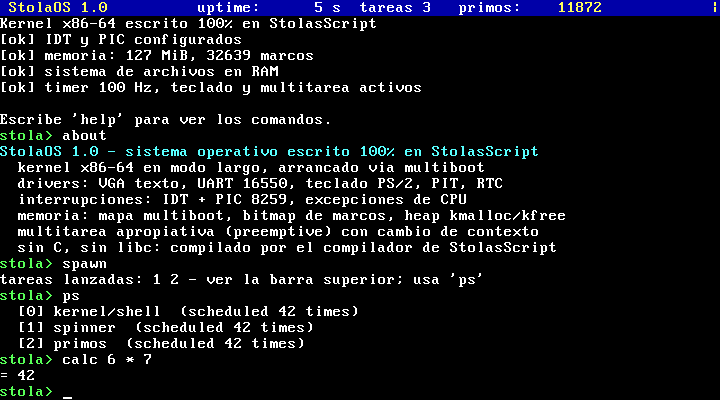

# StolasScript 2.0

StolasScript es un lenguaje **compilado a código máquina x86-64** con sintaxis
cómoda tipo Python (`end` cierra los bloques) y un sistema de tipos **inferido**:
el compilador descubre solo qué variables son enteros o booleanos y genera para
ellas instrucciones nativas en registros de la CPU, a velocidad de C. Lo que es
dinámico (listas, diccionarios, strings, objetos) usa un runtime pequeño.

Con el objetivo `--target kernel` el mismo lenguaje compila **sistemas
operativos sin una sola línea de C**: el compilador genera el arranque
multiboot y el paso a modo largo de 64 bits, y el resto lo escribes en
StolasScript. En `os/` hay un sistema operativo completo de ejemplo,
**StolaOS**, con drivers, interrupciones, memoria, sistema de archivos en RAM,
multitarea apropiativa y una shell.



```stola
function fib(n)              // sin anotaciones: el compilador infiere `int`
  if n < 2
    return n
  end
  return fib(n - 1) + fib(n - 2)
end

nombres = ["Asmodeus", "Paimon", "Bael"]
for nombre in nombres
  print(f"Hola {nombre}, fib(30) = {fib(30)}")
end
```

---

## Índice

1. [Instalación y uso](#instalación-y-uso)
2. [Los tres objetivos de compilación](#los-tres-objetivos-de-compilación)
3. [Guía del lenguaje](#guía-del-lenguaje)
4. [Velocidad: tipos inferidos y rendimiento](#velocidad-tipos-inferidos-y-rendimiento)
5. [Programación de sistemas (modo nativo)](#programación-de-sistemas-modo-nativo)
6. [StolaOS: un sistema operativo en StolasScript](#stolaos-un-sistema-operativo-en-stolasscript)
7. [Funciones y métodos integrados](#funciones-y-métodos-integrados)
8. [Concurrencia, red, FFI](#concurrencia-red-ffi)
9. [Pruebas y benchmarks](#pruebas-y-benchmarks)
10. [Limitaciones conocidas](#limitaciones-conocidas)

---

## Instalación y uso

Requisitos: `gcc` o `clang` (Linux) o `clang` (Windows) para compilar el
compilador y enlazar programas *hosted*; `as`/`ld` (binutils) para los objetivos
nativos; `qemu-system-x86_64` para arrancar StolaOS.

```bash
make                 # compila ./s y el runtime (lib/libstola.a)
make test            # suite de pruebas (incluye arrancar StolaOS en QEMU)
make bench           # StolasScript vs C vs Python
make run-os          # compila StolaOS y lo arranca en QEMU
```

```bash
./s run programa.stola [args...]               # compila y ejecuta
./s run --target linux programa.stola          # (las opciones van antes del archivo)
./s build programa.stola -o programa           # ejecutable nativo
./s build programa.stola --target linux        # binario estático, sin libc
./s build os/kernel.stola --target kernel      # imagen de kernel arrancable
./s programa.stola programa.s                  # solo genera ensamblador
```

Opciones: `-o <salida>`, `--target hosted|linux|kernel|freestanding`, `-S`
(solo ensamblador), `--keep-asm`, `-v` (muestra los comandos de ensamblado).
En Windows es igual con `s.exe` (necesita `clang` en el `PATH`).

---

## Los tres objetivos de compilación

| `--target` | Qué produce | Lenguaje disponible | Dependencias |
|---|---|---|---|
| `hosted` (por defecto) | ejecutable Linux/Windows | todo: listas, dicts, clases, closures, excepciones, hilos, red, FFI | runtime de StolasScript (en C) + `gcc`/`clang` para enlazar |
| `linux` | ELF estático de ~10 KB | subconjunto nativo: enteros, punteros, strings C, memoria estática, `syscall` | **ninguna**: ni libc ni C; solo `as` + `ld` |
| `kernel` | imagen multiboot x86-64 arrancable | subconjunto nativo + puertos E/S, registros de control, interrupciones | **ninguna**: el compilador genera el arranque |
| `freestanding` | archivo objeto `.o` | subconjunto nativo | para enlazar con tu propio código |

En los objetivos nativos (`linux`, `kernel`, `freestanding`) todos los valores
son palabras de máquina de 64 bits (enteros/punteros); no hay heap del runtime
ni recolección: el programa gestiona su memoria (como en C, pero con sintaxis
de StolasScript). `stdlib/linux.stola` (importado automáticamente en
`--target linux`) implementa la consola, `alloc`, archivos y utilidades de
strings **en StolasScript puro sobre syscalls**.

---

## Guía del lenguaje

### Sintaxis básica

```stola
nombre = "Stolas"          // variables (tipado inferido)
edad: int = 25             // anotación opcional
PI_APROX = 3.14159         // flotantes
nada = null                // también None
activo = true              // también True

# los comentarios pueden ser //, /* */ o #
x = 10 + 5 * 2             // operadores simbólicos...
y = 10 plus 5 times 2      // ...o en palabras (compatibles con la v1)
z = 2 ** 10                // potencia
b = (0xFF & 0b1010) << 2   // bits: & | ^ ~ << >>
n += 1                     // += -= *= /= %= &= |= ^= <<= >>= **=
a = 1; b = 2               // ';' separa sentencias en una línea
```

Comparaciones: `== != < > <= >=` o `equals`, `not equals`, `less than`,
`greater than`, `less or equals`, `greater or equals`, `is_greater_than`,
`is_less_than`. Lógicos: `and or not` (con cortocircuito; `a or b` devuelve
`a` si es verdadero, como en Python). Pertenencia: `x in lista`, `x not in d`.
Ternario: `valor = "par" if n % 2 == 0 else "impar"`.

### Strings

```stola
s = "hola mundo"
print(s.upper(), s.split(" "), s[0], s[-1], s[0:4], len(s))
print(f"{s} tiene {len(s)} bytes")          // f-strings
print("tab\t, salto\n, unicode ñ €, \x41")    // escapes
texto = """varias
lineas"""
print(", ".join(["a", "b"]), "ab" * 3, "{} y {}".format(1, 2))
```

### Listas y diccionarios

```stola
lista = [1, 2, 3]
lista.push(4)                  // o append(), push(lista, 4)
print(lista[0], lista[-1], lista at 1, lista[1:3], len(lista))
lista[0] = 100
dobles = lista.map(fn(x) => x * 2)
pares = lista.filter(fn(x) => x % 2 == 0)
total = lista.reduce(fn(a, b) => a + b, 0)

perfil = {"nombre": "Stolas", poder: 9000}   // claves sin comillas = strings
perfil["nivel"] = 3
perfil.titulo = "Príncipe"                    // acceso con punto
print(perfil.nombre, perfil.get("x", 0), "poder" in perfil)
for clave, valor in perfil
  print(clave, valor)
end
```

### Control de flujo

```stola
if edad > 18
  print("mayor")
elif edad == 18          // también `else if`
  print("justo 18")
else
  print("menor")
end

while n > 0
  n -= 1
end

for i in range(10)            // range(fin), range(ini, fin), range(ini, fin, paso)
  if i == 3
    continue
  end
  if i == 8
    break
  end
end

loop i from 0 to 10 step 2    // estilo v1 (fin exclusivo)
  print(i)
end

match comando
  case "start" => print("iniciando")
  case "stop"
    print("deteniendo")
  default => print("desconocido")
end
```

Los `:` al final de las cabeceras son opcionales (`if x > 1:`).

### Funciones, valores por defecto y closures

```stola
function saludar(nombre, saludo = "Hola")
  return f"{saludo}, {nombre}"
end

function sumar(a: int, b: int) -> int     // tipos explícitos (opcional)
  return a + b
end

function crear_contador()
  cuenta = {"n": 0}
  function incrementar()                  // función anidada = closure
    cuenta.n += 1
    return cuenta.n
  end
  return incrementar
end

c = crear_contador()
c(); c()
cuadrado = fn(x) => x * x                 // lambda corta
cubo = function(x)                        // lambda con bloque
  return x * x * x
end
f = sumar                                 // las funciones son valores
print(f(2, 3), cuadrado(4), cubo(2))
```

Las variables asignadas dentro de una función son locales (reglas de Python);
para modificar una global usa `global nombre`. Las closures capturan por valor
(para estado compartido usa un dict, una lista o un objeto).

### Clases, herencia y structs

```stola
class Animal
  function init(nombre)
    this.nombre = nombre          // `this` o `self`
  end
  function hablar()
    return this.nombre + " hace un sonido"
  end
end

class Perro extends Animal        // o: class Perro(Animal)
  function init(nombre, raza)
    super.init(nombre)
    self.raza = raza
  end
  function hablar()
    return f"{this.nombre} ladra"
  end
end

p = Perro("Rex", "pastor")        // o: new Perro("Rex", "pastor")
print(p.hablar(), p.raza)

struct Punto
  x
  y
end
pt = Punto(3, 4)
print(pt.x, pt)                    // Punto{x: 3, y: 4}
```

### Excepciones

```stola
try
  x = 10 / 0
catch e
  print("error:", e)              // ZeroDivisionError: division by zero
end

throw "algo salió mal"             // también `raise`
```

Los errores del runtime (`TypeError`, `IndexError`, `ZeroDivisionError`,
`AttributeError`, `ValueError`...) son excepciones capturables.

### Módulos

```stola
import utilidades          // busca utilidades.stola junto al archivo,
import os.vga              // en $STOLA_PATH y en stdlib/
import "ruta/otro.stola"
```

Importar ejecuta el código de nivel superior del módulo una sola vez y
comparte su espacio de nombres global.

### Constantes y memoria estática

```stola
const PUERTO_SERIE = 0x3F8          // constante de compilación
const SALUDO = "hola"
static buffer[4096] align 16         // bloque de memoria estática (dirección)
```

---

## Velocidad: tipos inferidos y rendimiento

El compilador hace **inferencia de tipos de todo el programa** (un punto fijo
monótono sobre variables, parámetros y valores de retorno):

* Si una variable solo recibe enteros, vive como `int64` nativo, normalmente en
  un registro (`rbx`, `r12`–`r15`) y las operaciones son instrucciones `add`,
  `imul`, `cmp`... directas. Lo mismo para booleanos.
* Los parámetros sin anotar toman el tipo de los argumentos en todas las
  llamadas: `fib(n)` sin anotaciones compila igual que en C.
* Si algo mezcla tipos (p. ej. `x = 1` y luego `x = "hola"`), se vuelve
  dinámico y usa el runtime automáticamente: la semántica no cambia.
* Las funciones usadas como valores reciben un *wrapper* dinámico, así que
  tipado y dinámico conviven sin que el programador haga nada.
* Optimizaciones: asignación de registros por frecuencia de uso, bucles
  `for i in range(...)` como contadores nativos, saltos directos para
  condiciones, reducción de fuerza para `* / %` por potencias de 2, constantes
  boxeadas precalculadas y pila alineada estáticamente.

Resultados de `make bench` (Linux x86-64; misma lógica en los tres lenguajes):

| benchmark | StolasScript | C `gcc -O2` | C `gcc -O0` | Python 3 |
|---|---:|---:|---:|---:|
| `fib(35)` recursivo | 0.08 s | 0.03 s | 0.10 s | 1.15 s |
| primos < 2 000 000 (división) | 0.67 s | 0.71 s | 0.65 s | 12.4 s |
| Collatz más largo < 1 000 000 | 0.39 s | 0.29 s | 0.49 s | 11.2 s |
| dinámico: dict + listas + strings | 0.07 s | – | – | 0.10 s |

El código numérico corre a velocidad de C (entre `-O0` y `-O2`) y entre 15 y
30 veces más rápido que Python; el código dinámico es comparable o algo más
rápido que Python.

> Consejo: el código del nivel superior usa variables globales (en memoria);
> pon los bucles críticos dentro de funciones para que sus variables vayan a
> registros.

---

## Programación de sistemas (modo nativo)

En los objetivos nativos dispones de intrínsecos que se compilan a
instrucciones en línea (sin llamadas):

| Intrínseco | Descripción |
|---|---|
| `load8/16/32/64(dir)` | lee memoria |
| `store8/16/32/64(dir, v)` | escribe memoria |
| `mem_copy(dst, src, n)`, `mem_set(dst, byte, n)` | `rep movsb` / `rep stosb` |
| `inb/inw/inl(puerto)`, `outb/outw/outl(puerto, v)` | E/S por puertos |
| `cli() sti() hlt() pause()` | control de la CPU |
| `lidt(p) lgdt(p) ltr(sel) invlpg(dir)` | tablas de descriptores / TLB |
| `read_cr0/2/3/4()`, `write_cr0/3/4(v)` | registros de control |
| `rdtsc() rdmsr(id) wrmsr(id, v) read_rsp() read_rflags()` | registros especiales |
| `addr_of(nombre)` | dirección de una función, `static` o variable |
| `call_ptr(dir, args...)` | llamada indirecta |
| `syscall(n, args...)` | llamada al sistema Linux |
| `argc()`, `argv(i)` | argumentos del proceso (`linux`) |
| `multiboot_info()`, `multiboot_magic()` | datos del cargador (`kernel`) |
| `as_str(p)` | trata un puntero como string C (para `print`) |
| `memory_read/write/write_byte` | alias compatibles con la v1 |

También existen:

* `interrupt function nombre()` — rutina de interrupción: guarda todos los
  registros volátiles, alinea la pila, termina con `iretq`. Con un parámetro,
  `interrupt function fallo(codigo)` recibe el código de error de la CPU.
* `asm { ... }` — ensamblador en línea (sintaxis Intel). Los nombres de
  variables, constantes, `static` y funciones se sustituyen por su ubicación
  real (`mov rax, contador` funciona). Comentarios con `;`, `#` o `//`.

Ejemplo de programa Linux sin libc (compílalo con
`./s build prog.stola --target linux` o ejecútalo con
`./s run --target linux prog.stola`; en `run` las opciones van antes del
archivo y lo que sigue al archivo son argumentos del programa):

```stola
static buffer[64]

function fib(n)
  if n < 2
    return n
  end
  return fib(n - 1) + fib(n - 2)
end

print("fib(30) =", fib(30))               // print usa stdlib/linux.stola
p = alloc(100)                             // heap sobre mmap, en StolasScript
str_copy(p, "copiado al heap")
print(as_str(p))
syscall(1, 1, "adios\n", 6)                // write(1, ...)
exit(0)
```

---

## StolaOS: un sistema operativo en StolasScript

`os/` contiene un kernel x86-64 escrito íntegramente en StolasScript (~1500
líneas, sin C ni archivos de ensamblador; solo unas pocas líneas de `asm { }`
en línea para `cpuid`, el cambio de contexto y leer un símbolo del enlazador):

| Módulo | Contenido |
|---|---|
| `kernel.stola` | punto de entrada, barra de estado, inicialización |
| `vga.stola` | consola de texto VGA 80×25 con colores, scroll y cursor |
| `serial.stola` | driver UART 16550 (COM1) |
| `console.stola` | `print` sobre VGA + serie |
| `interrupts.stola` | IDT de 256 entradas, PIC 8259 remapeado, excepciones de CPU (#DE, #UD, #DF, #GP, #PF) con pantalla de pánico |
| `timer.stola` | PIT a 100 Hz, `uptime`, `sleep_ms` |
| `keyboard.stola` | teclado PS/2 (IRQ1, mayúsculas, Bloq Mayús) + entrada por puerto serie |
| `memory.stola` | mapa de memoria multiboot, asignador de marcos físicos (bitmap), heap `kmalloc`/`kfree` con fusión de bloques |
| `tasks.stola` | **multitarea apropiativa**: cambio de contexto desde la interrupción del timer, pila propia por tarea |
| `fs.stola` | sistema de archivos en RAM |
| `shell.stola` | shell interactiva |

Comandos de la shell: `help`, `clear`, `echo`, `about`, `uptime`, `mem`, `cpu`
(`cpuid`), `date` (reloj CMOS), `calc`, `fib`, `primes`, `ls`, `write`,
`append`, `cat`, `rm`, `spawn` (lanza dos tareas de fondo que corren a la vez
que la shell), `ps`, `kill`, `color`, `panic`, `reboot`, `shutdown`.

```bash
make run-os
# o, a mano:
./s build os/kernel.stola --target kernel -o os/stolaos.bin
qemu-system-x86_64 -kernel os/stolaos.bin -serial stdio
```

El binario resultante (~22 KB) es una imagen *multiboot* estándar (probada con
QEMU; cualquier cargador multiboot como GRUB debería poder arrancarla). El
compilador genera la cabecera
multiboot, la tabla de páginas (4 GiB con páginas de 2 MiB), la GDT de 64 bits
y el salto a modo largo; después llama al código de nivel superior de
`kernel.stola`.

---

## Funciones y métodos integrados

**Generales:** `print(...)`, `len`, `str`, `int`, `float`, `bool`, `type`,
`range`, `min`, `max`, `abs`, `sum`, `sorted`, `reversed`, `keys`, `values`,
`contains`, `chr`, `ord`, `hex`, `join`, `input`, `exit`, `assert`, `copy`,
`args()`, `clock()`, `random()`, `random_int(a, b)`, `sqrt`, `pow`, `floor`,
`ceil`, `round`, `format_number(x, decimales)`, `to_string`, `to_number`,
`push`, `pop`, `shift`, `unshift`.

**Strings:** `upper lower strip lstrip rstrip split replace contains
starts_with ends_with find substring join repeat count chars is_digit is_alpha
format to_int len` (y las funciones de la v1: `string_split`, `uppercase`...).

**Listas:** `push/append pop shift unshift insert remove index_of contains
join reverse reversed sort sorted slice copy clear extend map filter reduce
each any all sum min max len`.

**Diccionarios:** `keys values items has get set remove copy clear update len`.

**Sistema:** `read_file`, `write_file`, `append_file`, `file_exists`,
`json_encode`, `json_decode`, `current_time` (ms), `sleep` (ms).

---

## Concurrencia, red, FFI

```stola
function tarea(id)
  return id * 2
end
h = thread_spawn(tarea, 21)            // hilo nativo (pthreads / Win32)
print(thread_join(h))                   // 42
m = mutex_create(); mutex_lock(m); mutex_unlock(m)

server = ws_server_create(8080)         // WebSockets RFC 6455
cliente = ws_server_accept(server)
ws_send(cliente, "hola")
print(http_fetch("http://example.com").status)

import_native "user32.dll"              // FFI con DLLs / .so
c_function MessageBoxA(h: number, t: string, c: string, tipo: number) -> number
MessageBoxA(0, "¡Hola!", "FFI", 0)
```

Sockets: `socket_connect/send/receive/close`. WebSockets: `ws_connect`,
`ws_send`, `ws_receive`, `ws_close`, `ws_server_create`, `ws_server_accept`,
`ws_server_close`, `ws_select(handles, timeout_ms)`.

---

## Pruebas y benchmarks

* `tests/hosted/` — programas con su salida esperada (`.out`).
* `tests/native/` — binarios `--target linux` (se verifica que sean estáticos
  y sin libc).
* `tests/errors/` — errores de compilación esperados.
* La suite arranca StolaOS en QEMU, escribe comandos por el puerto serie y
  comprueba la salida (shell, archivos, multitarea, apagado).
* `bench/` — mismos algoritmos en StolasScript, C y Python.

La integración continua (`.github/workflows/ci.yml`) ejecuta todo en Linux y
prueba la ABI de Windows x64 en Windows.

---

## Limitaciones conocidas

Para ser claros sobre lo que hay y lo que falta:

* **Memoria en modo hosted:** no hay recolector de basura; los valores
  dinámicos (strings, listas...) no se liberan. Los enteros y booleanos
  inferidos no usan el heap. Pensado para programas y servicios de duración
  moderada.
* **El compilador está escrito en C** y usa `as`/`ld` de binutils para
  ensamblar y enlazar. Los programas `linux` y `kernel` no contienen C, pero el
  compilador todavía no está escrito en StolasScript (no es autoalojado).
* Enteros de 64 bits con desbordamiento circular (como C, sin enteros
  ilimitados). `/` entre enteros trunca hacia cero; con flotantes es división
  real. `//` es comentario, no división entera.
* Los strings son secuencias de bytes UTF-8: `len("ñ") == 2`.
* Las closures capturan por valor; las llamadas dinámicas admiten hasta 10
  argumentos; `import` comparte un único espacio de nombres global.
* Los flotantes son dinámicos (en el heap); en los objetivos nativos no hay
  flotantes, clases, listas ni excepciones.
* StolaOS es un kernel educativo: corre todo en anillo 0, no tiene modo
  usuario, disco ni red.

Consulta `REPORTE_TECNICO.md` para el diseño interno del compilador.
